# Bragi brand

Bragi is the chat client for a private AI cloud (a Ymir cloud), named after the Norse god of poetry and eloquence. The mark is a lyre whose base curls into a speech-bubble tail.

## Palette

| Colour | Hex | Use |
|---|---|---|
| Mead Gold | `#F5B83D` | Mark, primary accent, buttons |
| Honey | `#FFE2A0` | Wordmark on dark, highlights |
| Rune Ink | `#14161B` | Dark background |
| Slate | `#2A2E37` | Raised surfaces, icon background |
| Glacier link | `#7FD4F5` | Links; ties Bragi to Ymir |

## Theme tokens

Dark is the default theme.

| Dark token | Value |
|---|---|
| `background` | `#14161B (Rune Ink)` |
| `surface` | `#1C1F26` |
| `surface-variant` | `#2A2E37 (Slate)` |
| `border` | `#3A3F4B` |
| `text` | `#F4F1E8` |
| `text-secondary` | `#A9ABB3` |
| `accent` | `#F5B83D (Mead Gold)` |
| `selection` | `#5A4518` |
| `link` | `#7FD4F5 (Glacier)` |
| `error` | `#FF5C70` |

| Light token | Value |
|---|---|
| `background` | `#FFF6DF` |
| `surface` | `#FFFFFF` |
| `text` | `#14161B (Rune Ink)` |
| `accent / mark` | `#B7791A (Mead Gold, darkened for contrast)` |
| `link` | `#0E3B5C` |

The app's desktop theme is `crates/bragi-desktop/src/theme.rs` and the Flutter theme is `app/lib/src/theme.dart`; both use these dark tokens. The busy/warm status colours (`#FF9F43`, `#4CD07D`) are functional and are not brand colours.

## Typography

| Role | Font | License |
|---|---|---|
| Wordmark and headings | Space Grotesk (Medium 500) | SIL Open Font License 1.1 |
| Body and UI | Inter | SIL Open Font License 1.1 |

Both are open-licensed and free to embed. The wordmark is converted to outlines in `brand/svg/`, so the SVGs
need no font installed. The sites self-host Inter (`site/web/fonts/LICENSE-Inter.txt`).

## Files (`brand/`)

- `svg/`: `bragi-mark`, `bragi-wordmark`, `bragi-lockup` (horizontal), each in dark (default), `-light`, `-black` and
  `-white` variants; `bragi-icon` (rounded app icon), `bragi-icon-square`, `bragi-android-foreground`,
  `-android-background`, `-android-monochrome`, and `bragi-social`. All hand-drawn, no raster, no filters.
- `png/hicolor/<size>/apps/bragi.png` (16 to 512) and `scalable/apps/bragi.svg` for Linux desktop icons.
- `png/android/`: adaptive icon (foreground, background, monochrome) at every density, legacy and round icons,
  `play-store-512.png`.
- `png/ios/AppIcon.appiconset` and `png/macos/AppIcon.appiconset` (+ `bragi.icns`), `png/windows/bragi.ico`.
- `png/favicon/`: `favicon.svg`, `favicon.ico`, 16/32 PNG, `apple-touch-icon.png`, 192 and 512.
- `brand-sheet.png`: the overview sheet. `licenses/`: the font licenses (OFL).
- `png/social/bragi-social-1200x630.png`.

## Usage

- Keep clear space around the mark of at least the width of the speech-bubble tail (about 1/8 of the mark's width).
- Minimum size: the mark 16 px high (use `favicon.svg`); the lockup 110 px wide.
- On dark backgrounds use the Mead Gold mark; on light backgrounds use `-light`; one-colour uses `-black` or `-white`.
- Honey is for the wordmark and highlights on dark; Glacier is for links only.
- Do not stretch, rotate, recolour outside the palette or drop the speech-bubble tail.
